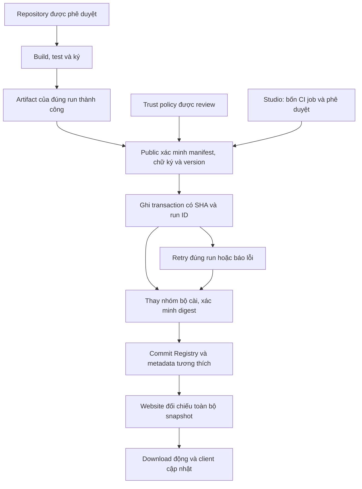

# Kiểm toán và triển khai phát hành tập trung Lịch AI

Ngày kiểm tra: 19/10/2026. Phạm vi: 7 repository yêu cầu, cộng LichAI-iOS và LichAI-Shop được phát hiện trong danh sách có quyền. Không merge, không chạy publish production trong đợt chuẩn bị PR.

## 1. Kết luận có bằng chứng

| Repository | Luồng đang có | Điểm thiếu / thay đổi đề xuất |
|---|---|---|
| Android | main → Gradle APK/AAB có ký → apksigner → artifact → upload Public → dispatch changelog | Không đồng bộ app-versions trên web; đổi sang thu nhận artifact từ toàn bộ run đã thành công |
| TV | main → Gradle ký → APK/AAB artifact → Public → changelog | Thiếu bước verify độc lập và đồng bộ phiên bản; bổ sung apksigner, chỉ Public được publish |
| Desktop | Tauri → EXE/MSI artifact → upload chung → changelog → website dispatch | Run 39227156364 build/upload thành công nhưng dispatch sang Lich-AI lỗi HTTP 404; bộ cài đã bị thay trước khi cả run thành công |
| Translator | Hai workflow build/test riêng, publish EXE + JSON | JSON asset không còn trong Release chung tại thời điểm audit; catalogue sinh adapter metadata trong repository và website |
| Studio | validate + Windows + Android + emulator; PR merge hoặc manual publish-existing; checks version/signature/hash | Giữ nguyên bốn kiểm thử và quyền phê duyệt; publish chuyển thành artifact studio-publication; Public kiểm tra lại nguồn và group |
| Public | Changelog dispatch và restore riêng | Restore trước đây tìm artifact mới nhất còn hạn, thiếu pin provenance cho các ứng dụng ngoài Studio; thay bằng run ID/hash chính xác; các entrypoint cũ gọi reusable reconciler |
| Lich-AI | 4 card chính viết cố định + windows-utilities.json; Desktop và Studio sync riêng | Trang mới sinh card từ registry; một workflow đồng bộ toàn bộ snapshot, không tin số version trong payload |
| iOS | Build simulator/unsigned hoặc ký khi đủ cấu hình | Chưa có IPA chính thức trong Public; không tự biến artifact simulator thành bộ cài chính thức |
| Shop | Build web và media/queue | Website, không có bộ cài desktop/mobile; không công bố asset giả |

### Desktop

[Run lỗi](https://github.com/nvhiepbk/LichAI-Desktop/actions/runs/39227156364) có bước Build Windows installer, Upload Windows bundles và Publish fixed Desktop downloads đều success. Bước Sync published Desktop version to website lỗi `gh: Not Found (HTTP 404)` lúc 09:07:27 UTC. Lỗi này tương thích với token không truy cập được repository/dispatch; API hiện có không cho phép đọc secrets nên chưa kết luận cụ thể token hết hạn hay thiếu phạm vi.

Source Tauri/Cargo và `CURRENT_VERSION` đang là 0.6.0; website `static/app-versions.json` ghi 0.6.1. PR Desktop chuẩn bị 0.6.2 ở cả ba nơi và thêm bước sinh version hiển thị trước khi package. Đây là bản build mới sau duyệt, không đổi version website để đoán theo file vừa được upload.

### Studio

Public `apps/studio.json`: verified_head `60ba8b15d97a2497292372d4d8f48dd0573dbe92`; Windows hash `79f4ed0c5ae55ed7de05efc8cfd6a754e02f037fb6122cfc09820aed1b15e37f`.
Website `static/studio-release.json`: verified_head `20d3a811229e35e9fb0db286b9f7d98852744637`; Windows hash `5891e870591b8a31ee4fa09f642a80caaa8917b8de6d3257ad1d110c8760b7e1`.

Public API digest hiện khớp metadata Public. Website có dữ liệu cũ. Registry mới không tự gắn nhãn verified cho dữ liệu chuyển đổi chưa đối chiếu artifact nguồn.

### Tám URL

`audit-release-assets-2026-10-19.json` ghi lại size/digest/URL từ GitHub Release. `audit-download-head-2026-10-19.json` ghi kiểm tra HEAD theo redirect: **8/8 HTTP 200**, Content-Length trùng size API. Đây là kiểm tra truy cập và digest do GitHub cung cấp, không phải đã tải lại toàn bộ binary để tính SHA trong phiên kiểm toán.

## 2. Kiến trúc

Public polling 15 phút; website polling lệch 7 phút, cũng có manual/dispatch đánh thức. Dispatch không cấp quyền và không cung cấp version đáng tin cậy. Không cần token nguồn gọi dispatch sang website để đồng bộ. Tự động có độ trễ của lịch GitHub Actions (có thể muộn hơn lịch khi GitHub bận), không cam kết thời gian thực.

`registry/trusted-sources.json` xác định repository, workflow, artifact, đường dẫn manifest và quyền sở hữu tên asset. Source manifest đọc tại SHA bất biến của run. Workflow source và script trong artifact không bao giờ được thực thi trên Public. Artifact ZIP được kiểm tra hạn, path traversal và digest nếu API cung cấp. APK kiểm tra apksigner, chứng thư, versionName và versionCode trong binary. EXE parse PE; MSI parse compound file. Windows hiện không có Authenticode trong workflow cũ, được ghi rõ unsigned; không giả vờ đã có chữ ký. Các định dạng ZIP, DEB, RPM, PKG, DMG, AppImage có kiểm tra cấu trúc/header cơ bản và checksum; chữ ký required chưa có verifier sẽ bị từ chối.

## 3. Giao thức ứng dụng mới

1. Tạo manifest theo `registry/manifest.schema.json`; tham khảo manifest trong PR từng ứng dụng. Một app có danh sách installers, nhiều platform/format; số app độc lập số file.
2. Build/test/sign trên main; upload artifact v4 sau thành công. Cấu hình version_source (Gradle, Tauri JSON, plain VERSION, hoặc Studio handoff) và changelog_path. Không tự upload Public.
3. Chủ hệ thống review một mục trust policy cấp quyền đúng repository/workflow/artifact và những asset cụ thể. Việc quản trị này bắt buộc; không tự cho phép repository mới chỉ vì tên gần giống LichAI.
4. Public tự phát hiện run thành công mới nhất, xác minh toàn nhóm và đăng ký app. Website tự có card, filter, logo, nút, QR, phiên bản và ngày mà không sửa HTML hay pages/download.py.
5. Thêm platform/asset cần mở rộng manifest và quyền sở hữu trong policy qua review; không sửa giao diện.

Mỗi group có một phiên bản stable; không công bố một nửa EXE/MSI hoặc Windows/Android của Studio. SHA và byte-size xác minh lại từ Public trước khi commit metadata. Cùng version nhưng bytes khác bị từ chối sau lần xác minh đầu tiên; cần tăng version khi build mới khác binary. versionCode lấy từ Gradle/APK, không suy từ SemVer.

## 4. Quyền và cấu hình

Không đọc được danh sách, giá trị hay phạm vi thực tế của GitHub Actions secrets qua connector hiện tại. Các tên dưới đây lấy từ workflow đã đọc, không khẳng định chúng đang được cấu hình đúng.

| Nơi | Secret / variable | Quyền cần thiết |
|---|---|---|
| Public | RELEASE_SYNC_TOKEN | Source repositories: Contents read, Actions read; Public: Contents write để thay release assets. Fine-grained token chỉ các repo được duyệt. Không cần quyền Actions write hoặc administration |
| Public | GITHUB_TOKEN mặc định | Contents write để commit registry/pending/adapters; workflow khai báo phạm vi này |
| Public | REGISTRY_ENABLED | Mặc định chưa có/false = chỉ dry-run; true cho phép apply ở workflow reconciliation |
| Lich-AI | GITHUB_TOKEN | Read Public API, Contents write với repository website |
| Lich-AI | RELEASE_SYNC_TOKEN (nếu cần kích hoạt workflow deploy theo push) | Token checkout/push có Contents write vào Lich-AI. Dùng để push metadata, tránh quy tắc GITHUB_TOKEN không kích hoạt workflow theo push |
| Lich-AI | REGISTRY_ENABLED | true chỉ sau khi toàn bộ 6 app / 8 installers đã verified |
| Android | LICHAI_KEYSTORE_B64, LICHAI_KEYSTORE_PASSWORD, LICHAI_KEY_ALIAS, LICHAI_KEY_PASSWORD | Giữ keystore hiện có |
| TV | LICHAI_TV_KEYSTORE_BASE64, LICHAI_TV_KEYSTORE_PASSWORD, LICHAI_TV_KEY_ALIAS, LICHAI_TV_KEY_PASSWORD | Giữ khóa ký hiện có |
| Studio | STUDIO_KEYSTORE_BASE64, STUDIO_STORE_PASSWORD, STUDIO_KEY_ALIAS, STUDIO_KEY_PASSWORD | Giữ signing và CI hiện có |

Sau cutover, các source workflow không cần RELEASE_SYNC_TOKEN/PUBLIC_RELEASE_TOKEN để ghi Public nữa. Chỉ thu hồi sau nghiệm thu. Không thay token/keystore trong PR. Nếu branch rules chặn bot commit main, quản trị viên cần cấp đường ghi phù hợp hoặc thay commit trực tiếp bằng PR metadata; phiên này không sửa rules hay bypass.

## 5. Thứ tự merge/deploy có kiểm soát

1. Review và merge PR Public trước, giữ REGISTRY_ENABLED=false. Chạy registry checks; provision/check token mới ở Public. Dry-run chưa có source manifest sẽ báo lỗi rõ, không đổi bộ cài.
2. Review và merge các PR Android, TV, Desktop, Translator và Studio. Chúng ngừng ghi trực tiếp Release chung, giữ build/test/sign/upload artifact. Giữ website hiện hành phục vụ link cũ trong giai đoạn này. Các artifact cũ không có manifest không được tự suy diễn và phát hành.
3. Chờ các main build hoàn tất. Studio chỉ tạo handoff sau merge PR đã vượt đủ bốn job, hoặc manual `publish-existing` với SHA đã được kiểm thử; không chạy artifact PR chưa phê duyệt.
4. Chạy Public `Reconcile verified application releases`, apply=false. Review report đủ 6 app / 8 installers, version, source SHA, run ID, APK certificate và checksum.
5. Sau chủ repository phê duyệt, đặt Public REGISTRY_ENABLED=true; manual apply=true. Registry chuyển từng app từ migration_pending sang published sau xác minh. Desktop mục tiêu 0.6.2 lớn hơn metadata website 0.6.1. Không đưa dữ liệu giả lập lên production.
6. Chạy audit `python scripts/release_registry.py --audit` trong môi trường có token/SDK. Chạy lại dry-run/apply kiểm tra idempotency; đủ 8 URL HTTP 200 và không pending transaction.
7. Chỉ sau bước 6 mới merge PR website. **PR website không được merge nguyên snapshot migration_pending**: trước merge, đưa `metadata/application-registry.json` và `metadata/app-versions.json` đã verified từ Public vào `static/`, cùng `metadata/studio-release.json`. Có thể chạy `python scripts/sync_application_registry.py` trên nhánh PR; review rồi commit snapshot trong chính PR. Script sẽ từ chối nếu còn bất kỳ app chưa verified hoặc downgrade. Sau merge đặt website REGISTRY_ENABLED=true để đồng bộ định kỳ.
8. Xác minh /download, /app/static/app-versions.json, Studio SEO và các client thật. Build Desktop/Android/TV mới phát hiện cập nhật từ client phiên bản trước; không thể kết luận thử nghiệm thiết bị thật từ unit test. Xác minh deployment backend đang đọc commit website mới; metadata push bằng PAT dùng cho các workflow deploy theo push.

Không merge, enable variable hay chạy apply production trong quá trình chuẩn bị PR. PR là kết quả cụ thể để chủ repo review.

## 6. Recovery và giới hạn cố hữu của URL cố định

Public writer dùng chung một concurrency group, không cancel publish dở. Restore/changelog workflows cũ cũng gọi cùng reusable workflow và khóa này. Trước upload ghi `registry/pending.json` vào git với exact run, sha và expected hashes. Bản metadata mới chỉ commit sau cả group tồn tại và khớp digest. Lỗi thông thường rollback các asset đã thay từ backup, pending giữ để retry. Nếu runner chết hoặc rollback lỗi, lần chạy sau bỏ qua mismatch của riêng app pending rồi tải đúng run, so lại hashes để hoàn tất. Không dùng artifact mới nhất bất kỳ để chữa lỗi.

Artifact đã hết hạn/xóa: dừng và báo; không dựng lại cùng version và tự coi bytes là tương đương. Cần khôi phục đúng bytes đã ghi nhận, hoặc build version mới có phê duyệt. Thiếu asset đã published: restore từ provenance run ID/hash; asset hiện có bị đổi trái registry: dừng để điều tra. Certificate thay đổi: từ chối; cần migration ký được review.

GitHub Release không có thao tác atomic cho nhiều asset cùng URL cố định. Trong khoảng thay EXE/MSI, người tải trực tiếp có thể gặp cửa sổ ngắn asset chưa đồng nhất. Transaction journal, xác minh group và rollback giảm rủi ro; không tuyên bố loại bỏ hoàn toàn giới hạn của GitHub. Muốn atomic tuyệt đối cần immutable version URLs và một lớp chuyển hướng giao dịch, trái yêu cầu giữ URL GitHub hiện tại.

Website lỗi mạng: không ghi file snapshot và giữ bản commit trước. Nếu Public có pending chưa hoàn tất, website digest check thất bại và không công bố metadata mới. Việc client đã giữ metadata cũ tải URL cố định trong thời gian thay asset vẫn chịu giới hạn trên.

## 7. Kiểm thử và nghiệm thu

Đã chạy local: 27 tests Public, 10 tests catalogue website, 5 tests tương thích Studio website, 2 tests Studio verified-run; integration verify_download xác minh đủ 8 URL/nút/QR và mọi PNG hợp lệ; Python compile và YAML parse. Có dry-run bằng API/artifact giả lập kiểm tra exact run, không có lệnh ghi Release. Chưa chạy publish end-to-end bằng token production; không tạo app thử trên Public.

| Tình huống yêu cầu | Kiểm tra |
|---|---|
| App 9 Windows; app 10 Android/Windows; thêm platform | Schema và renderer fixtures, không sửa UI |
| Update một app; EXE/MSI group | Group success giữ nguyên app khác, projection hai URL |
| Artifact lỗi; chưa phê duyệt; metadata thiếu | Format/schema, fork/main/run gates, Studio merged-PR và bốn job |
| Đồng thời; rerun | Một global writer lock; cùng bytes idempotent; khác bytes cùng version bị chặn |
| Artifact hết hạn/xóa | Stage từ chối, không fallback |
| Website không truy cập | Giữ snapshot trước, không ghi khi fetch lỗi |
| Recovery sau lỗi | Mock upload failure rollback cả group; pending exact run; recovery mismatch riêng group pending |
| 8 URL cũ | API size/digest snapshot và HEAD 8/8 HTTP 200 |

CI mới kiểm tra Public và website trên PR. Native Windows/Android/Flutter build của source chủ yếu chạy main hoặc Studio PR; không gọi lại workflow có quyền publish cũ chỉ để lấy dấu CI xanh. Sau source merge, nghiệm thu native build là bước bắt buộc trước apply.
